# Laboratorio S12 · Rompe la arquitectura

**Curso:** AIS86 — Arquitectura de Software  
**Institución:** Universidad Nacional Micaela Bastidas de Apurímac (UNAMBA)  
**Fecha:** 18 de noviembre de 2026  
**Entorno:** Docker Desktop, Docker Compose, Nginx, Redis, Kubernetes y kind  
**Sistema de referencia:** FLASH SALE  
**Responsable del registro:** Equipo de laboratorio

## Registro de experimentos

En cada prueba provocamos una falla, observamos la respuesta del sistema y comprobamos qué componente arquitectónico intervino. Las capturas son registros de la ejecución realizada en el laboratorio.

| Exp. | Qué rompimos | Qué vimos (evidencia) | Qué pieza lo resolvió y cómo | Integrante |
|:---:|---|---|---|:---:|
| **A2–A3** | Provocamos la caída del único contenedor con `POST /crash`. Repetimos la prueba con la política de reinicio `unless-stopped`. | Primero, `curl` devolvió **Empty reply from server** y `solo` terminó en **Exited (1)**. Con reinicio automático volvió a **Up**, pero su contador regresó a **1**. [Ver evidencia](evidencias/A2-A3/A3_reinicio_automatico.png). | **Contenedor (Docker):** la política `unless-stopped` recuperó el proceso; el contador se perdió porque estaba en memoria. | Equipo |
| **B2** | Detuvimos `api-2` con Nginx bien configurado y repetimos el fallo usando `nginx-defectuoso.conf`. | Con Nginx correcto hubo **0 errores**; las otras dos réplicas siguieron respondiendo. Con la configuración defectuosa aparecieron **19 errores en 192 peticiones acumuladas**. [Ver evidencia](evidencias/B2/B2a_nginx_correcto_monitor.png). | **Balanceador (Nginx):** los reintentos de `proxy_next_upstream` y la detección de fallas permitieron enviar solicitudes a réplicas disponibles. | Equipo |
| **B3** | Comparamos los contadores separados en memoria de cada réplica con un único contador alojado en Redis. | En memoria vimos **1388, 1388 y 179**. Tras activar Redis, las tres réplicas mostraron la etiqueta **redis (compartido)** y lecturas consecutivas **899, 900 y 898**, con **0 errores**. [Ver evidencia](evidencias/B3/B3_antes_redis.png). | **Estado compartido (Redis):** las réplicas pasaron a consultar y actualizar un mismo contador, en lugar de mantener copias independientes. | Equipo |
| **B4** | Volvimos lenta una réplica con `POST /lento` y comparamos `round robin` contra `least_conn` bajo ocho peticiones simultáneas. | Con `round robin`, la réplica lenta atendió **133/410 (32,4 %)**. Con `least_conn`, atendió **9/358 (2,5 %)**. Ambas mediciones tuvieron **0 errores**. [Ver evidencia](evidencias/B4/B4_round_robin.png). | **Balanceador (Nginx):** `least_conn` priorizó las instancias con menos conexiones activas y redujo la proporción asignada a la réplica lenta. | Equipo |
| **C3–C4** | En C3 borramos el pod `api-78ccc9885b-n76vj`. En C4 provocamos la caída del proceso de otro pod mediante `POST /crash`. | Kubernetes creó `api-78ccc9885b-d5hcx`, que pasó por **Pending → ContainerCreating → Running**. Más tarde ese pod registró **RESTARTS = 1** y volvió a **1/1 Running**. [Ver evidencia](evidencias/C3-C4/C3_pod_borrado_recreacion.png). | **Orquestador (Kubernetes):** Deployment/ReplicaSet creó el pod que faltaba y kubelet reinició el contenedor cuando murió su proceso. | Equipo |
| **C6** | Apagamos por completo el nodo `ais86-worker` ejecutando `docker stop ais86-worker`. | El nodo pasó a **NotReady** y el monitor acumuló **24 errores**. La carga afectada se recuperó mediante el pod `api-78ccc9885b-t5gpw` en `ais86-worker2`. Luego el nodo volvió a **Ready**. [Ver evidencia](evidencias/C6/C6_monitor_durante_falla.png). | **Clúster y orquestador (Kubernetes):** el clúster mantuvo nodos alternativos y reprogramó la carga, aunque la recuperación no fue inmediata. | Equipo |
| **C7** | Simulamos una nueva revisión con el health check roto al aplicar `ROMPER_HEALTH=1` al Deployment. | El pod nuevo quedó en **0/1 Ready** y registró un reinicio; los tres pods anteriores siguieron en **1/1**. El monitor mostró **879 solicitudes y 0 errores**. Al finalizar, la variable defectuosa ya no figuraba en el Deployment. [Ver evidencia](evidencias/C7/C7_pod_no_ready.png). | **Orquestador y health checks (Kubernetes):** la sonda de disponibilidad impidió enviar tráfico al pod defectuoso y la estrategia de despliegue conservó instancias sanas. Se recuperó la revisión anterior. | Equipo |

## Pregunta final del equipo

**En nuestro sistema, ¿cuál de las fallas de hoy nos afectaría más y qué pieza de las cuatro la previene?**

En FLASH SALE, la falla que más nos afectaría sería la caída de la API de pedidos durante una venta, porque impediría confirmar compras justo cuando los usuarios necesitan una respuesta confiable. Lo vimos en A2: cuando teníamos una sola instancia y el proceso murió, el servicio dejó de responder. Para reducir ese riesgo, la pieza principal sería un **orquestador** como Kubernetes, encargado de mantener disponibles las réplicas y recuperar las que fallen, junto con un **balanceador** que reparta las solicitudes entre las instancias sanas. También comprobamos con Redis que la información compartida no debería quedar aislada en la memoria de cada réplica; en FLASH SALE, los pedidos y el stock deben mantenerse en almacenamiento persistente y con controles que eviten duplicaciones cuando se reintenta una operación.

## Evidencias de ejecución

Las capturas se conservan dentro de `docs/evidencias/` y pueden visualizarse directamente en el repositorio. Las imágenes corresponden a las pantallas y terminales obtenidas durante las pruebas; no se reconstruyeron resultados.

### A2–A3

La prueba dejó clara la diferencia entre recuperar un proceso y recuperar su estado. El reinicio funcionó, pero el contador almacenado en memoria no sobrevivió.

**A3: contenedor recuperado y contador reiniciado.**

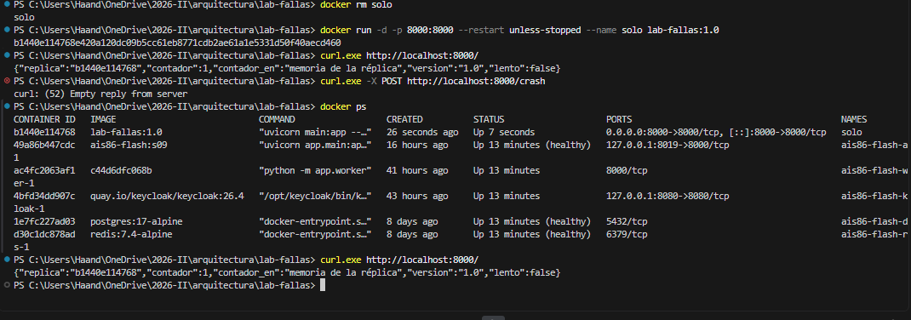

**A1: contador antes de provocar las fallas.**

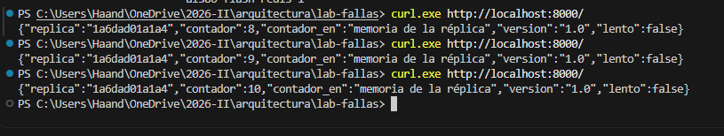

- [Registro textual de la caída A2](evidencias/A2-A3/A2_salida_terminal.txt)

### B2

La configuración del balanceador sí cambió el resultado: al caer la misma réplica, con Nginx correcto no hubo errores registrados y con la configuración defectuosa sí.

**Nginx correcto: dos réplicas activas, sin errores.**

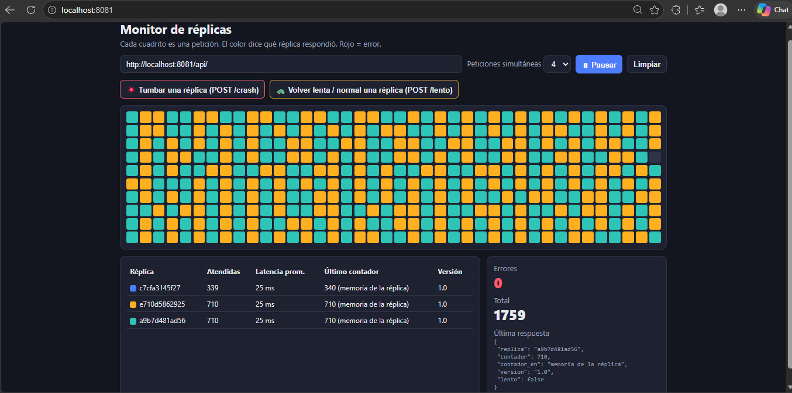

**Nginx defectuoso: cuadros rojos y 19 errores.**

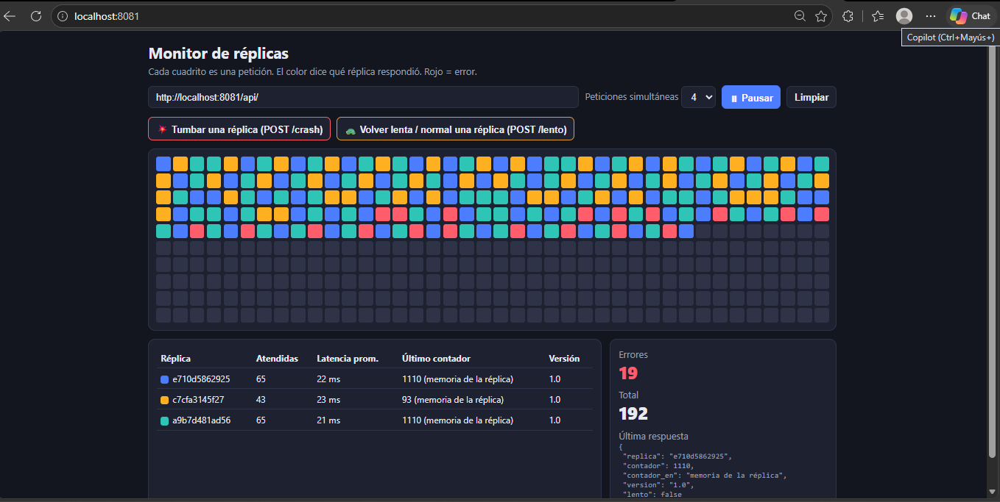

**Consola: detención de la réplica.**

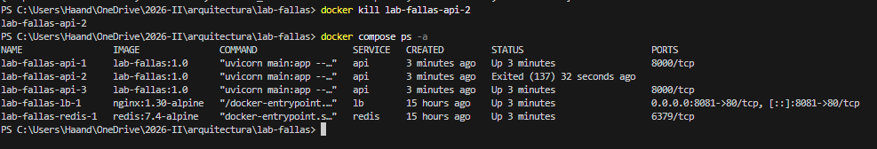

### B3

Aunque las lecturas de Redis no son idénticas, todas corresponden al mismo contador global, observado en instantes diferentes.

**Contadores distintos antes de Redis.**

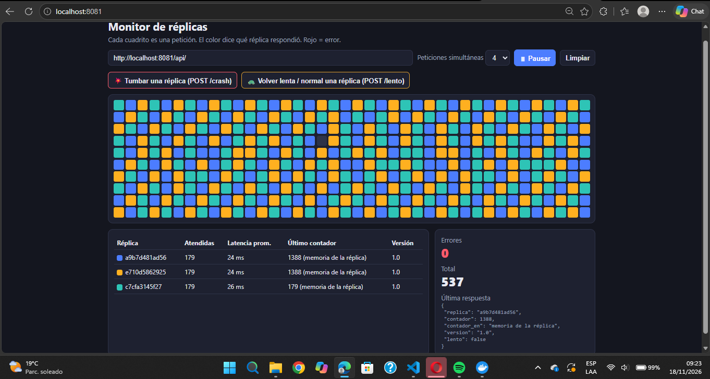

**Un único contador compartido con Redis.**

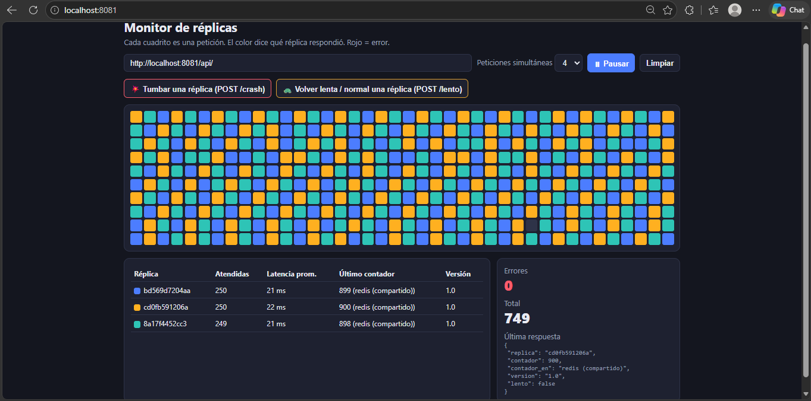

### B4

Se compararon porcentajes y no solo cantidades porque las dos muestras tuvieron tamaños diferentes: 410 y 358 peticiones.

**Round robin: reparto casi uniforme pese a la lentitud.**

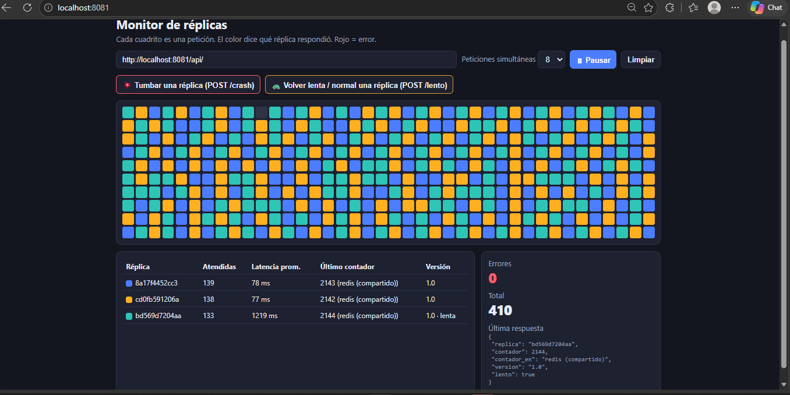

**Least connections: menor proporción a la réplica lenta.**

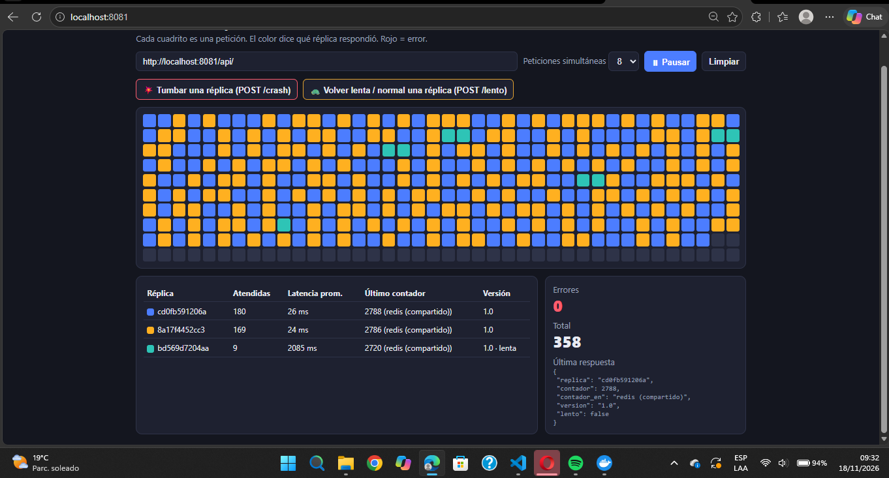

**Modificación del upstream de Nginx.**

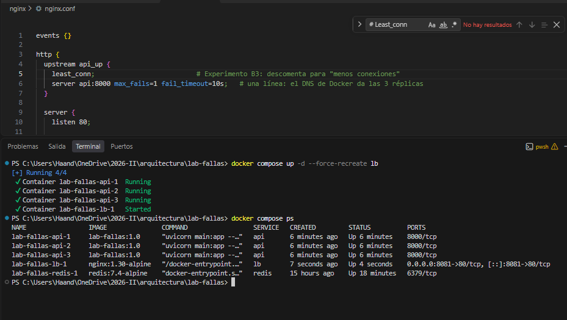

### C3–C4

Al borrar un pod cambió su identificador. Al caer solamente el proceso, se mantuvo el pod y aumentó el número de reinicios.

**C3: seguimiento de la eliminación y el reemplazo.**

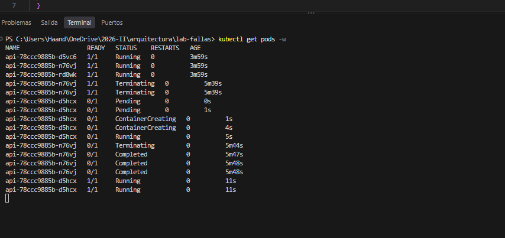

**C4: el mismo pod volvió con RESTARTS = 1.**

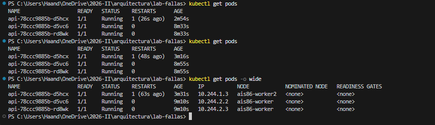

### C6

La recuperación del nodo no fue instantánea: hubo un periodo con errores antes de que Kubernetes dejara de dirigir tráfico hacia la carga afectada.

**Durante la caída: 24 errores acumulados.**

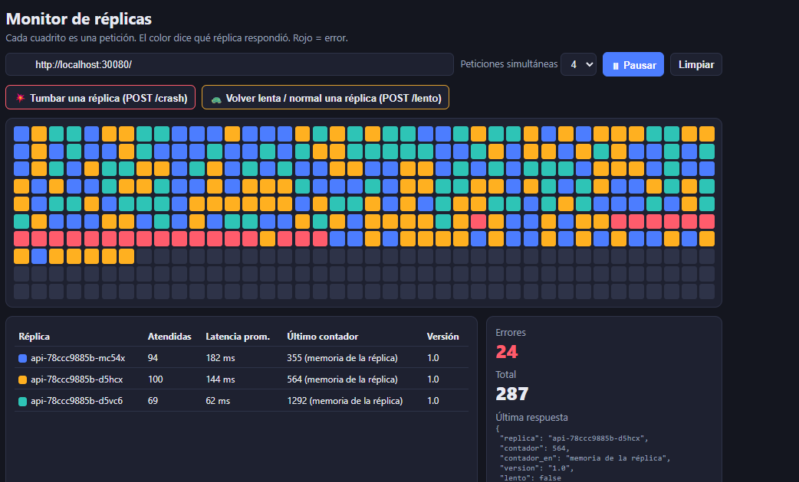

**Terminal: NotReady, nuevo pod y nodo restaurado.**

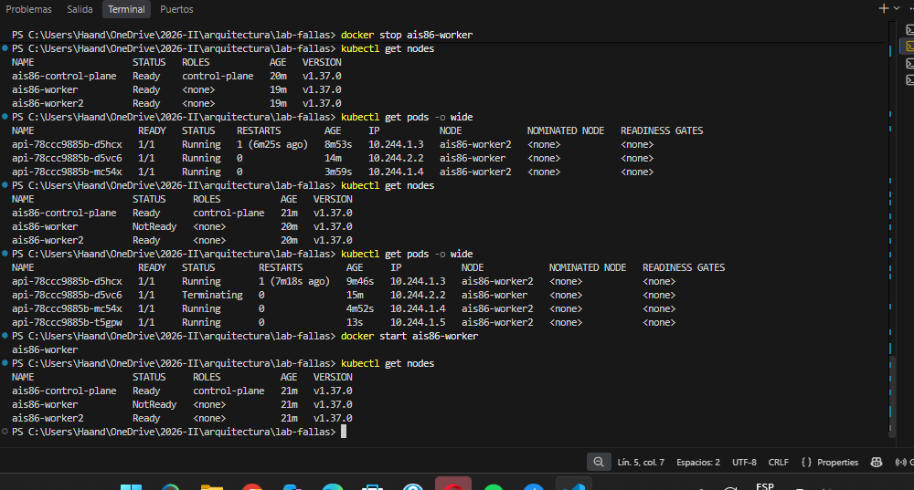

**Monitor tras estabilizarse.**

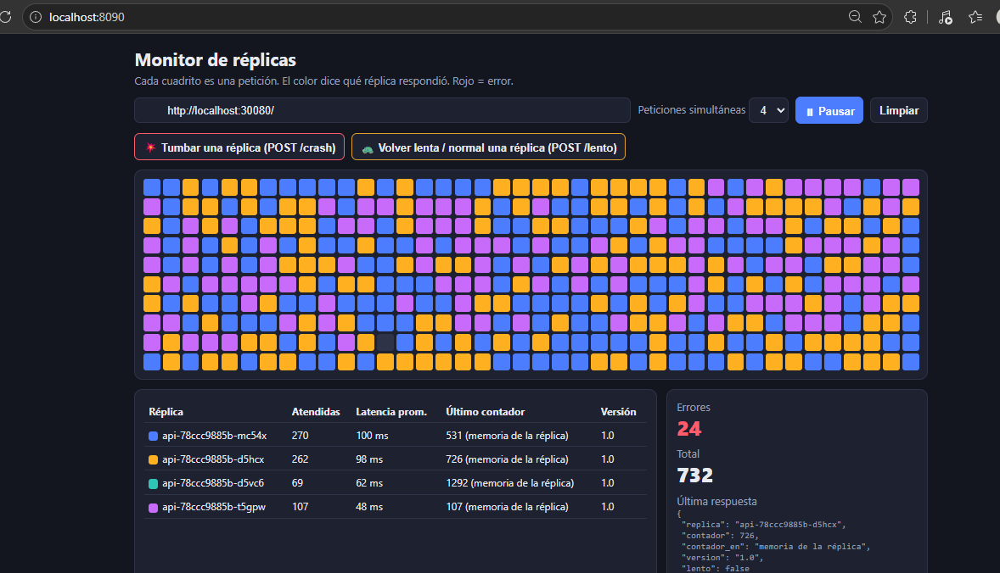

### C7

La aplicación siguió respondiendo mientras la nueva revisión fallaba. En esta práctica la reversión fue una intervención manual, no un rollback automático.

**Pod nuevo 0/1; réplicas anteriores sanas.**

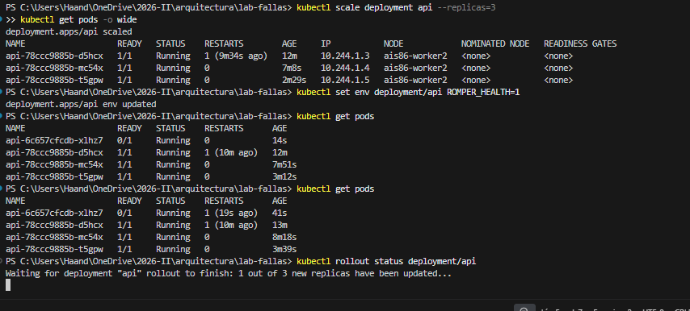

**Monitor sin errores durante el despliegue.**

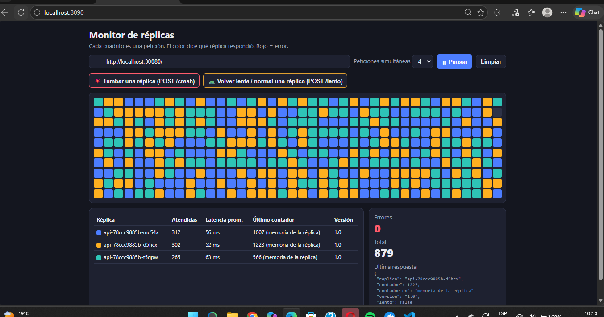

**Despliegue estable tras la restauración.**

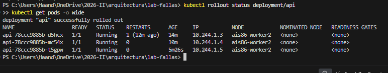

### Registro complementario: preparación, escalamiento y limpieza

Además de los siete experimentos evaluables, verificamos el clúster de tres nodos, el escalamiento de tres a cinco réplicas y la eliminación de los recursos del laboratorio local al finalizar. Estas capturas documentan ese recorrido.

- [Clúster creado (C1)](evidencias/Extras/C1_cluster_creado.png)
- [Monitor con Kubernetes (C2)](evidencias/Extras/C2_monitor_kubernetes.png)
- [Cinco pods activos (C5)](evidencias/Extras/C5_cinco_pods.png)
- [Monitor con cinco réplicas (C5)](evidencias/Extras/C5_monitor_cinco_replicas.png)
- [Limpieza final del clúster y monitor (C8)](evidencias/C8/C8_limpieza.png)

## Resultado general

Las pruebas mostraron que la recuperación depende de la pieza arquitectónica implicada: Docker puede reiniciar un proceso, Nginx distribuye tráfico entre réplicas, Redis evita mantener estados independientes y Kubernetes repone contenedores o pods según el estado deseado. También observamos límites: los datos en memoria se pierden con el reinicio y la caída de un nodo puede causar errores temporales mientras el clúster detecta la falla. El laboratorio local se cerró con el clúster `ais86` y el monitor retirados, mientras los servicios de FLASH SALE continuaron activos.
